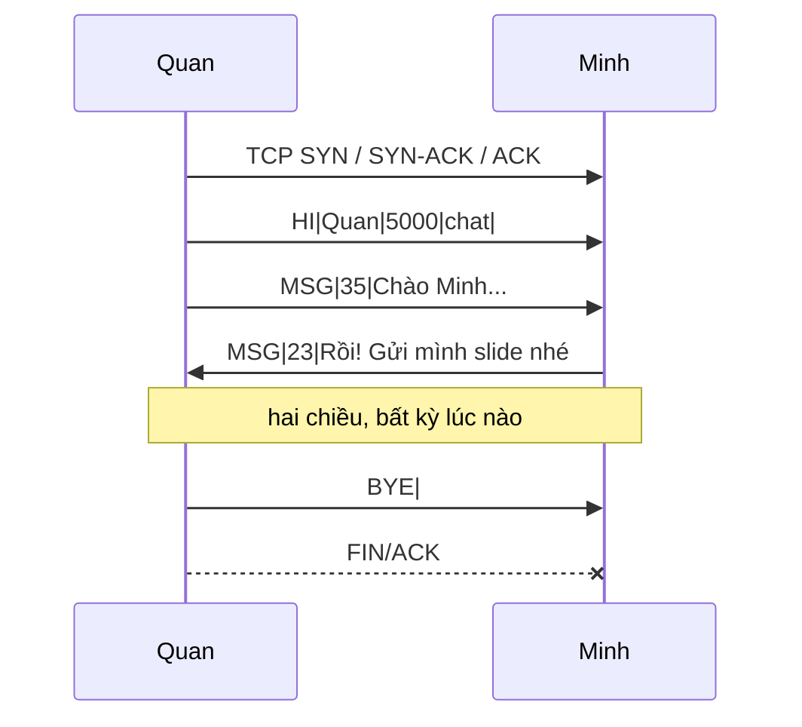
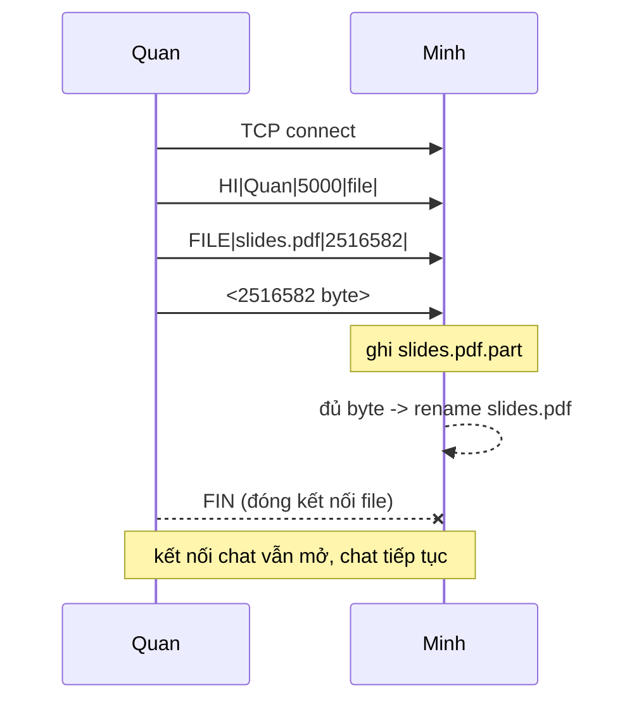

# Đặc tả giao thức — LAN Chat v1.0

> Trạng thái: **đã chốt** cho sprint 3 ngày. Mọi thay đổi phải cập nhật file này,
> tăng số version và sửa test tương ứng.
>
> Người duy trì: **B** (TCP framing) + **A** (UDP discovery) · cả nhóm review.

---

## 1. Vai trò hai giao thức

| | UDP | TCP |
|---|---|---|
| Cổng | `9999` (mặc định) | `<tcp_port>` mỗi peer (mặc định 5001) |
| Dùng cho | khám phá peer, trạng thái online/away | chat, gửi file |
| Tính chất | 1 datagram = 1 thông điệp, có thể mất | dòng byte, tin cậy, không có ranh giới thông điệp |
| Hệ quả | mất `HELLO` không sao, 3 s sau có gói mới | **bắt buộc framing theo độ dài** |

---

## 2. UDP — gói hiện diện

### 2.1 Định dạng

```
HELLO|<name>|<tcp_port>|<status>
```

| Trường | Kiểu | Ràng buộc |
|---|---|---|
| `HELLO` | literal | đúng 5 ký tự |
| `<name>` | UTF-8 | 1–32 ký tự printable, **không chứa `\|`** (bị thay bằng `_`) |
| `<tcp_port>` | decimal | 1–65535 |
| `<status>` | literal | `online` hoặc `away` (giá trị lạ → coi là `online`) |

Ví dụ (không có ký tự xuống dòng, không có `|` ở cuối):

```
HELLO|Quan|5000|online
HELLO|Minh|6000|away
```

### 2.2 Quy tắc gửi

- Mỗi peer gửi **mỗi 3 giây** (`BROADCAST_INTERVAL`).
- Đổi `/status` → gửi **ngay** rồi mới quay lại nhịp 3 giây.
- Gửi bằng socket ephemeral (`bind(("", 0))`) + `SO_BROADCAST`; **không** bind cổng 9999 để tránh tranh chấp với listener.
- Đích mặc định `255.255.255.255:9999`; có thể truyền nhiều `--bcast`, ví dụ `127.255.255.255` khi offline.
- Giới hạn thực tế: mỗi datagram < 1400 byte (an toàn cho MTU); hiện payload < 80 byte.

### 2.3 Quy tắc nhận

- Bind `("", 9999)`, bật `SO_REUSEADDR` (+ `SO_REUSEPORT` nếu có) để nhiều instance trên một máy cùng nghe.
- Bỏ qua datagram sai định dạng, không log, không crash (nguồn lạ có thể gửi rác).
- **Bỏ qua gói của chính mình**: trùng `name` **và** `tcp_port`.
- Cập nhật `PeerTable[name] = (ip nguồn, tcp_port, status, now)`.
- Mỗi giây quét timeout: peer nào `now - last_seen > 10 s` → xoá + sự kiện `offline`.
- 10 s ≈ 3 gói `HELLO` liên tiếp bị mất → đúng tinh thần "mất gói UDP là chấp nhận được".

### 2.4 Sự kiện sinh ra

| Điều kiện | Sự kiện | UI |
|---|---|---|
| Lần đầu thấy tên, status `online` | `online` | `[*] Minh is online (192.168.1.12).` |
| Lần đầu thấy tên, status `away` | `online` | `[*] Minh is away (192.168.1.12).` |
| Đã biết, `status` đổi | `status` | `[*] Minh is now away.` |
| Quá 10 s | `offline` | `[*] Minh is offline.` |
| IP/port đổi nhưng status giữ nguyên | `update` | im lặng |

---

## 3. TCP — khung thông điệp

### 3.1 Bảng frame

| Type | Cú pháp | Payload | Dùng ở đâu |
|---|---|---|---|
| `HI` | `HI\|<name>\|<tcp_port>\|<purpose>\|` | không | **frame đầu tiên** của mọi kết nối TCP; `purpose` = `chat`/`file` |
| `MSG` | `MSG\|<nbytes>\|<nbytes byte UTF-8>` | text | chat |
| `FILE` | `FILE\|<quoted-name>\|<size>\|<size byte nhị phân>` | nhị phân | gửi file |
| `BYE` | `BYE\|` | không | kết thúc chat / thoát |

- Không có `\n`, không có ký tự kết thúc frame: **độ dài** quyết định payload.
- Header luôn kết thúc bằng `|` (byte `0x7C`).
- `<nbytes>` và `<size>` là số **byte**, không phải số ký tự.
  Ví dụ `Chào Minh, sẵn sàng demo chưa?` = 30 ký tự nhưng **35 byte UTF-8**.
- `MSG` tối đa **1 MiB**; header tối đa **4096 byte**.
- `FILE` size ≥ 0; bên nhận kiểm tra đủ byte và dung lượng đĩa trước khi đổi tên file.
- `purpose` cho server quyết định route **ngay sau `HI`**: `chat` → `ChatSession`, `file` → `FileService`. Nhờ vậy bên nhận chat biết đối tác ngay và có thể là người gửi tin đầu tiên, không phải chờ frame kế tiếp.

### 3.2 Ví dụ byte-level

```
HI|Quan|5000|chat|
MSG|35|Chào Minh, sẵn sàng demo chưa?
FILE|slides.pdf|2516582|<2 516 582 byte nhị phân>
BYE|
```

Tên file có dấu cách / dấu `|` / tiếng Việt:

```
tên gốc        : báo cáo | final.pdf
trường trên dây: b%C3%A1o%20c%C3%A1o%20%7C%20final.pdf
frame          : FILE|b%C3%A1o%20c%C3%A1o%20%7C%20final.pdf|1024|<1024 bytes>
```

Quy tắc: `urllib.parse.quote(basename, safe="")` khi gửi, `unquote()` khi nhận.
Nhờ vậy dấu `|` không bao giờ xuất hiện trong trường tên file và header vẫn
tách được bằng `split("|")`. Tên nhận về còn được lọc `basename`, ký tự điều
khiển, tên Windows reserved (`CON`, `PRN`,…), cắt còn 120 ký tự.

### 3.3 Grammar

```
frame      = hi / msg / file / bye
hi         = "HI"      "|" name "|" port "|" purpose "|"
msg        = "MSG"     "|" number "|" *OCTET
file       = "FILE"    "|" qname "|" number "|" *OCTET
bye        = "BYE"     "|"
name       = 1*32UTF8  ; printable, "|" bị thay bằng "_"
port       = number    ; 1..65535
purpose    = "chat" / "file"
qname      = percent-encoded UTF-8 basename
number     = "0" / %x31-39 *DIGIT     ; không âm
OCTET      = %x00-FF
```

### 3.4 Thuật toán đọc (bắt buộc)

Không được giả định `1 recv() = 1 frame`.

```
buffer = b""
def ensure(pipes):
    while buffer has fewer than `pipes` '|':
        if len(buffer) > HEADER_MAX: raise ProtocolError
        chunk = recv(65536)
        if chunk == b"": raise ConnectionClosed
        buffer += chunk

def read_header():
    ensure(1)
    t = text before first '|'
    if t == "HI":   ensure(4); parse name, port, purpose; consume header
    if t == "MSG":  ensure(2); parse nbytes;      consume header
    if t == "FILE": ensure(3); parse qname, size; consume header
    if t == "BYE":  consume "BYE|"
    else: raise ProtocolError

def read_exact(n):
    while len(buffer) < n: recv more
    take n bytes from buffer
```

`FILE` payload được đọc theo chunk 64 KiB và ghi thẳng xuống file `.part`,
không nạp cả file vào RAM:

```
for chunk in iter_payload(size): file.write(chunk)
```

### 3.5 Vòng đời kết nối

**Chat (1 kết nối / cặp peer, tái sử dụng):**



**File (kết nối riêng, đóng sau khi xong):**



**Thoát / mất mạng:**

| Tình huống | Trên dây | Bên còn lại |
|---|---|---|
| `/leave` | `BYE|` rồi FIN | `[*] Quan left the chat.` |
| `/quit` | `BYE|` trên mọi kết nối, ngừng `HELLO` | sau 10 s: `[*] Quan is offline.` |
| Peer crash | không có `BYE`, OS gửi RST/FIN | `recv()` trả `b""`/lỗi → `[*] Connection with Quan lost...` |
| Rút Wi-Fi giữa lúc gửi file | không có gì | hai bên báo lỗi, bên nhận xoá `.part` |

### 3.6 Chống trùng kết nối

Hai peer có thể cùng bấm `/chat` nhau. Quy tắc chốt:

> Kết nối do **bên có tên nhỏ hơn theo lexicographic** khởi tạo sẽ thắng.

Cả hai bên áp dụng cùng quy tắc:

- Tên nhỏ hơn: nếu đang có kết nối **incoming** từ bên kia mà mình mở `/chat`, mở kết nối outgoing mới và đóng incoming cũ.
- Tên lớn hơn: nhận incoming từ bên nhỏ hơn và đóng outgoing cũ của mình.
- Cùng chiều (hiếm): giữ kết nối mới, đóng kết nối cũ.

Nhờ vậy hai bên luôn hội tụ về **một** socket duy nhất, không có trạng thái nửa sống nửa chết.

---

## 4. Bảng giới hạn & hằng số

| Hằng số | Giá trị | Nơi dùng |
|---|---|---|
| `BROADCAST_INTERVAL` | 3.0 s | presence |
| `PEER_TIMEOUT` | 10.0 s | peer table |
| `SWEEP_INTERVAL` | 1.0 s | listener |
| `CONNECT_TIMEOUT` | 5.0 s | `/chat`, gửi file |
| `HEADER_MAX` | 4096 byte | FrameReader |
| `MAX_MESSAGE` | 1 MiB | `MSG` |
| `RECV_CHUNK` / `FILE_CHUNK` | 64 KiB | đọc/ghi |
| `PROGRESS_STEPS` | 25/50/75/100 | UI |

---

## 5. Xử lý lỗi ở tầng protocol

| Lỗi | Hành vi |
|---|---|
| Frame type lạ | `ProtocolError` → đóng **kết nối đó**, in `[!] Rejected connection from <ip>: ...` |
| Header > 4096 byte | như trên |
| `MSG` length âm / > 1 MiB | như trên |
| `FILE` size âm | như trên |
| `FILE` thiếu byte (peer đóng sớm) | xoá `.part`, báo lỗi, không crash |
| Frame đầu không phải `HI` | đóng kết nối (dùng `nc` để test) |
| `MSG`/`FILE` đến trên chat connection | coi là lỗi protocol, đóng chat đó |

---

## 6. Test vector (đã có trong `tests/test_protocol.py`)

| Input | Kỳ vọng |
|---|---|
| `MSG\|10\|Chào Minh` | length = 10 byte, text = `Chào Minh` |
| hai `MSG` gửi trong 1 `sendall` | đọc được 2 frame riêng |
| gửi frame từng byte một | vẫn đọc đúng |
| `FILE\|...%7C...\|5\|hello` | tên giải mã có `|`, payload `hello` |
| `BYE\|` | type `BYE` |
| `GARBAGE\|` | `ProtocolError` |
| `MSG\|-5\|` | `ProtocolError` |
| 5000 byte `A` không có `|` | `ProtocolError` |
