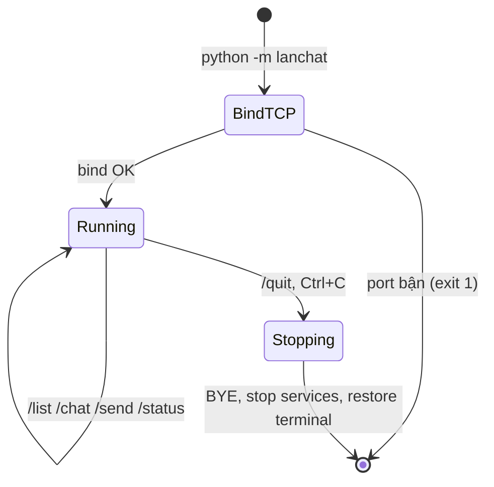

# Kiến trúc & mô hình luồng

> Người duy trì: **C** · A và B review trước khi báo cáo nộp.

---

## 1. Bức tranh tổng thể

Mỗi máy chạy đúng một chương trình, đóng cả hai vai:

```
                 ┌───────────────────────────── App ─────────────────────────────┐
                 │  name, tcp_port, udp_port, status, download_dir               │
                 │                                                               │
  bàn phím ────► │  Console (main thread) ──► commands ──► ChatSession ──┐      │
                 │        ▲                                             │ TCP  │
  UDP 9999 ◄────►│  DiscoveryListener ──► PeerTable (lock)              ├──► peer
  UDP 9999 ◄────►│  PresenceService (3 s)                               │      │
                 │                                                      │      │
  TCP <port> ◄──►│  ChatServer (acceptor) ──► handler thread ───────────┘      │
                 │                              └──► FileService ──► file-tx-*│
                 └───────────────────────────────────────────────────────────────┘
```

- **Không có server trung tâm**: mỗi peer tự mở TCP port và tự quảng bá.
- **Không có thư viện ngoài**: `socket`, `threading`, `queue` (không dùng), `pathlib`, `argparse`.
- **UI một luồng**: chỉ main thread đọc phím; các thread khác gọi `Console.show()` và được lock bảo vệ.

---

## 2. Bảng luồng

| Thread | Chờ gì | Trách nhiệm | File |
|---|---|---|---|
| `MainThread` | bàn phím | đọc từng phím, giữ buffer, chạy lệnh, gửi tin | `ui/console.py`, `ui/commands.py` |
| `udp-presence` | timer 3 s | gửi `HELLO`; `set_status()` đánh thức gửi ngay | `discovery/presence.py` |
| `udp-listener` | datagram UDP | parse `HELLO`, cập nhật `PeerTable`, quét timeout 1 s | `discovery/listener.py` |
| `tcp-acceptor` | kết nối TCP mới | `accept()`, tạo 1 thread cho mỗi kết nối | `chat/server.py` |
| `tcp-conn-<ip>` | dữ liệu trên kết nối đó | đọc `HI`, phân loại chat / file | `chat/server.py` |
| `chat-rx-<peer>` | dữ liệu trên chat socket | hiển thị `MSG`, xử lý `BYE`, đếm unread | `chat/session.py` |
| `file-tx-<peer>` | đĩa + socket | gửi file theo chunk, báo % | `chat/files.py` |
| file receiver | chạy trong `tcp-conn-*` | ghi `.part`, rename, xoá khi lỗi | `chat/files.py` |

Tổng số thread: 1 main + 2 UDP + 1 acceptor + N kết nối + M file đang gửi.
Đây là mô hình đơn giản nhất đúng với đề (mục 5.1); `select/poll` là phương án
thay thế nhưng khó demo hơn.

---

## 3. Trách nhiệm từng module

| Module | Biết gì | Không biết gì |
|---|---|---|
| `protocol.py` | byte layout, buffering, giới hạn | peer là ai, UI ra sao |
| `discovery/peers.py` | tên/IP/port/status/thời gian | socket, UI |
| `discovery/presence.py` | tên + port + status + địa chỉ broadcast | danh sách peer |
| `discovery/listener.py` | parse datagram, timeout | TCP |
| `chat/server.py` | accept, `HI`, route frame đầu | nội dung tin nhắn |
| `chat/session.py` | kết nối chat, partner, unread, trùng kết nối | gửi file |
| `chat/files.py` | đọc/ghi file, `.part`, %, tên an toàn | TCP chat |
| `ui/console.py` | màn hình, buffer, ANSI | mạng |
| `ui/commands.py` | cú pháp lệnh | socket trực tiếp |
| `app.py` | nối mọi thứ, callback, shutdown | chi tiết từng giao thức |

Quy tắc: module dưới **không import** module trên (ví dụ `protocol.py` không
import `app.py`).

---

## 4. Dữ liệu chia sẻ & lock

| Dữ liệu | Nơi giữ | Lock | Ai ghi | Ai đọc |
|---|---|---|---|---|
| danh sách peer | `PeerTable._peers` | `RLock` | listener, `on_peer_seen` | main, session |
| lịch sử chat | `ChatHistory._messages` | `RLock` | receiver, main | receiver, main |
| unread counter | `ChatHistory._unread` | cùng lock | receiver | main |
| kết nối chat | `ChatSession._conns` | `RLock` | session, receiver | session, main |
| dòng nhập + màn hình | `Console` | `RLock` | main (echo), mọi thread (`show`) | — |
| `stop` | Event từng service | — | main | service |

**Không giữ lock của module này khi gọi `Console.show()` của module khác.**
Ví dụ trong `ChatSession._drop()`, lock được nhả trước khi in thông báo.
Nhờ vậy không có deadlock kiểu "thread A giữ session lock chờ console lock,
trong khi main giữ console lock chờ session lock".

Thứ tự lock nếu buộc phải lồng: `Console` → `ChatSession` → `ChatHistory` → `PeerTable`.
Thực tế code hiện tại **không lồng lock nào** giữa các module.

---

## 5. Luồng dữ liệu

### 5.1 Một tin nhắn đi

```
gõ "hello" + Enter
  -> Console (main) gọi on_line("hello")
  -> commands.handle_line -> App.send_chat_message
  -> ChatSession.send_text -> socket.sendall(MSG|5|hello)
  -> ChatHistory.add(author=me)
  -> Console.show("[Quan] hello")
```

### 5.2 Một tin nhắn đến

```
chat-rx-Minh: reader.read_header() -> MSG
  -> reader.read_text(5) -> "hello"
  -> App.on_chat_message("Minh", "hello")
     -> nếu Minh là partner: ChatHistory.add + Console.show("[Minh] hello")
     -> nếu không: ChatHistory.add + Console.show("[*] New message from Minh (1 unread)")
```

### 5.3 Gửi file không chặn chat

```
/send a.pdf
  -> App.send_file -> FileService.send_async -> thread file-tx-Minh
     -> TCP connect (kết nối MỚI)
     -> HI|Quan|5000|chat|
     -> FILE|a.pdf|2516582| + 2 516 582 byte
     -> mỗi 25%: App.on_file_progress -> Console.show
  -> main thread vẫn đọc phím và gửi MSG trên kết nối chat cũ
```

### 5.4 Nhận file

```
tcp-conn-192.168.1.12: accept
  -> read HI -> peer
  -> read FILE header
  -> FileService.receive
     -> downloads/a.pdf.part  (64 KiB mỗi lần)
     -> đủ size? rename -> downloads/a.pdf
     -> lỗi/thiếu byte? xoá .part, in lỗi
  -> đóng kết nối file, kết nối chat không bị ảnh hưởng
```

---

## 6. Vòng đời khởi động / thoát



Thứ tự shutdown trong `App.shutdown()`:

1. `ChatSession.close_all()` → gửi `BYE` trên mọi kết nối.
2. `presence.stop()` → ngừng quảng bá.
3. `listener.stop()` + `server.stop()` → đóng socket, đánh thức thread.
4. `join(timeout=1.0)` từng thread.
5. `Console.stop()` → xuống dòng, khôi phục terminal.

---

## 7. Những quyết định có chủ ý

| Quyết định | Lý do | Đánh đổi |
|---|---|---|
| Thread cho mỗi kết nối | code rõ, demo dễ giải thích, đúng gợi ý đề | nhiều thread nếu nhiều peer |
| Mỗi file 1 kết nối | chat không block, không chèn FILE giữa MSG | thêm 1 lần bắt tay TCP |
| `Console.show()` từ mọi thread | không cần hàng đợi message | phải giữ lock màn hình đúng |
| Percent-encode tên file | giữ format pipe của đề mà vẫn an toàn | Wireshark đọc tên hơi khó hơn |
| Không mã hoá | đúng phạm vi đồ án | không dùng ngoài LAN tin cậy |
| Không lưu lịch sử ra đĩa | giảm rủi ro, đủ demo | mất khi thoát |
